# flr

**the factory floor** — a terminal cockpit for your machines.

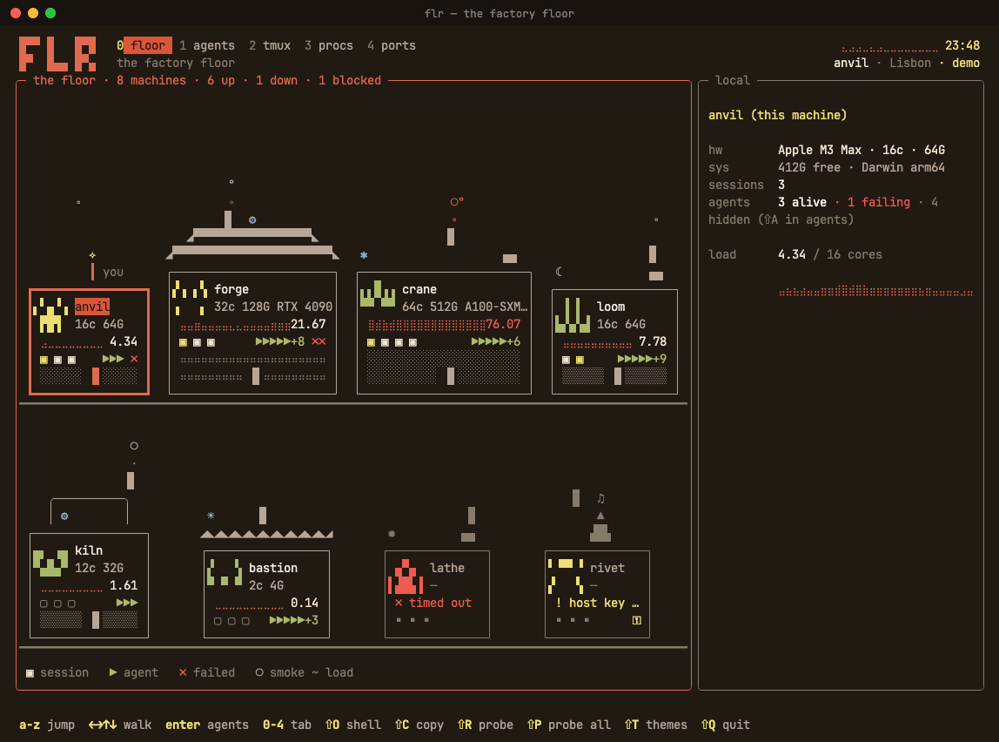

The **machine is the unit**: `local` plus every `Host` in `~/.ssh/config`,
each probed for reachability, hardware (CPU/cores/RAM/disk/GPU/load), tmux
sessions, running agents, top processes and listening ports. flr opens on
**the floor** — every machine at once, with the selected one's details
beside it. The other tabs show a section of the selected machine, with the
machine rail on the left.

No agent to install anywhere: everything remote is one `ssh` round-trip of
plain POSIX commands, multiplexed over a shared connection.

> Every screenshot here is flr's built-in **demo mode** — a fictional fleet
> (`anvil`, `forge`, `crane`, …) on documentation-only addresses. Run
> `bun run demo` to walk it yourself without touching a single real machine.

## try it

Requires [Bun](https://bun.sh) ≥ 1.3, plus `ssh` and (optionally) `tmux`.

```bash
git clone https://github.com/cifarra/flr.git
cd flr
bun install
bun run demo     # the fictional fleet from the screenshots
bun start        # your machines: local + every Host in ~/.ssh/config
```

To keep it handy, put a wrapper somewhere on your `PATH`:

```bash
#!/bin/bash
exec bun run /path/to/flr/src/index.tsx "$@"
```

## the floor

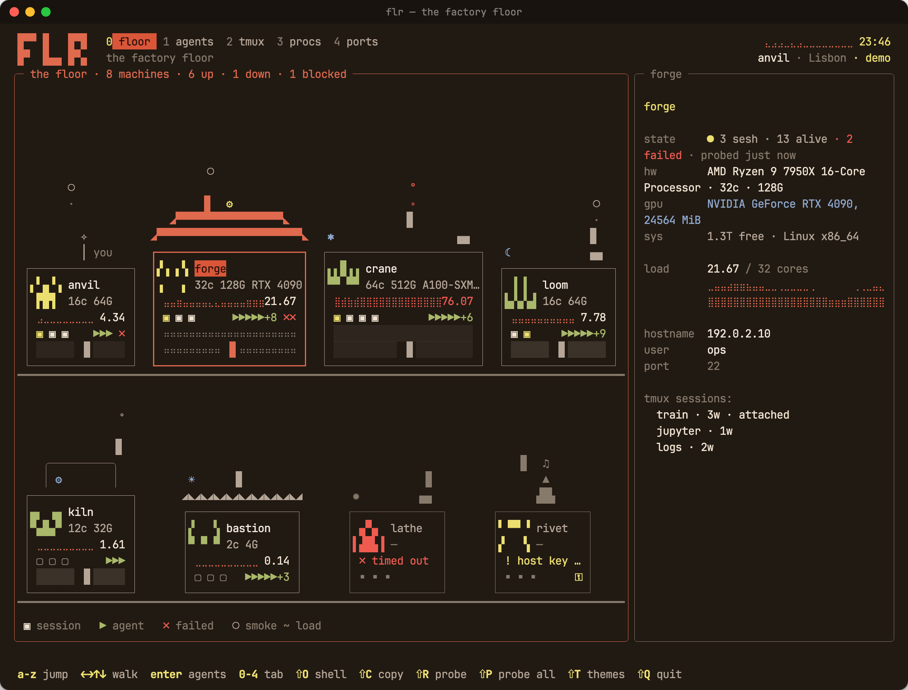

`0` — the entire floor on one canvas. Every machine is a building on a
street, and every building is *that* machine's: roof line (sawtooth, gable,
flat with a water tank, penthouse, spire), rooftop flag, facade texture and
chimney placement are hashed from its name, so it looks the same every time
you open flr and different from its neighbours. Height follows core count.
The local machine is the tower with the blinking beacon — you are here.

What's inside is live:

- the **sign** — hostmark emblem (state-colored) · name · `32c 128G RTX 4090`
- the **pulse** — that machine's load trace and reading
- **windows** `▣` — one per tmux session, bright when attached; dark `▢ ▢ ▢`
  when the building is empty
- **workers** `▶▶▶▶▶+8` — running agents; `✗` per failing one
- **smoke** — puffs from the chimney in step with load: a lazy wisp at idle,
  a steady stream under load, red when past the core count

Unreachable hosts go dark with `✗ timed out` on the door; auth-blocked ones
are `⚿` locked with a `!`; a dashed outline hasn't been probed yet. The floor
sits on the bottom of the window with sky above; when it outgrows the window
it scrolls to keep the selection in view. `←→` walk along a street, `↑↓` hop
to the building nearest in the street above/below, letters jump straight to a
host by name, `enter` steps into its agents.

## sections

| tab | what it shows | actions |
|-----|---------------|---------|
| **0 floor** | the whole fleet as a street of buildings + the selected machine's info | `←→↑↓` walk · `enter` into agents · `⇧R` probe · `⇧P` probe all |
| **1 agents** | launchd jobs locally · systemd services / launchd jobs on remotes, failed first | local: run, load/unload, tail logs · everywhere: `⇧R` restart, `/` filter, `⇧A` show hidden |
| **2 tmux** | that machine's tmux sessions (+ new-session / plain-shell rows on remotes) | attach, kill |
| **3 procs** | top ~20 processes by CPU (%CPU / %MEM / pid) | `⇧X`×2 kill, `⇧K`×2 kill -9, `⇧R` refresh |
| **4 ports** | listening TCP sockets (port · process · bind address) | `⇧X`×2 kill owner, `⇧K`×2 kill -9, `⇧R` refresh |

<table>
  <tr>
    <td>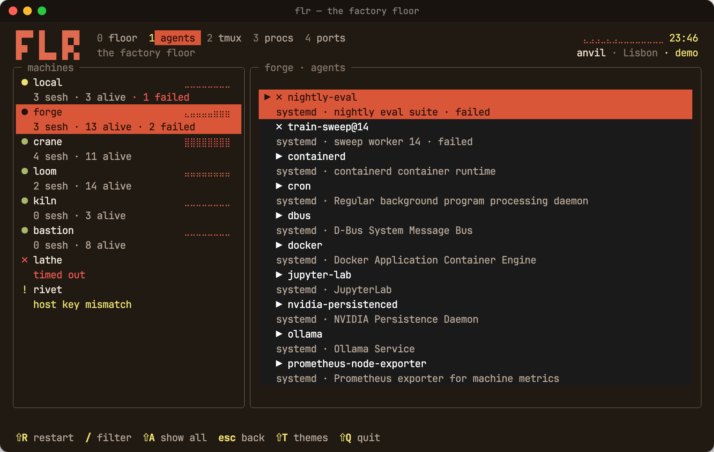</td>
    <td>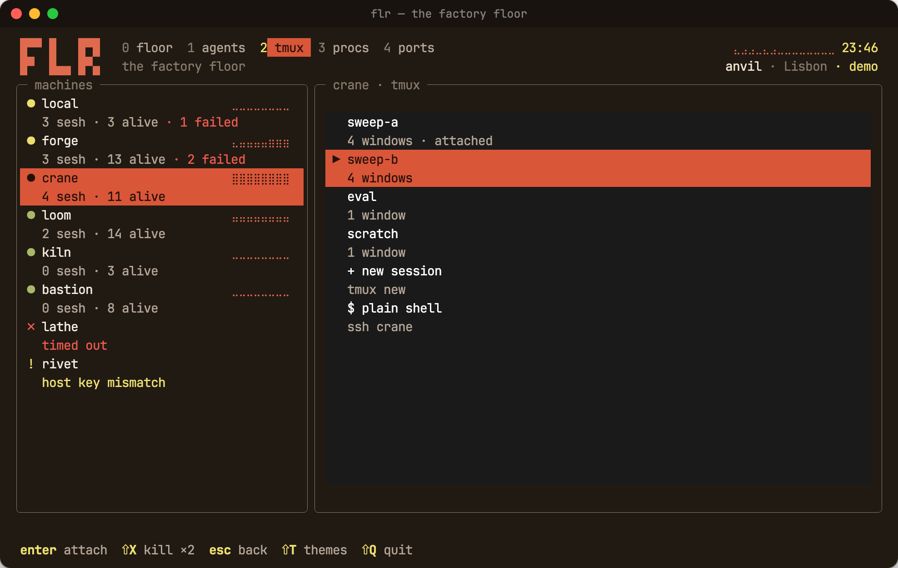</td>
  </tr>
  <tr>
    <td align="center"><b>agents</b> — failed first, so they get eyes</td>
    <td align="center"><b>tmux</b> — attach, kill, or open a new session</td>
  </tr>
  <tr>
    <td>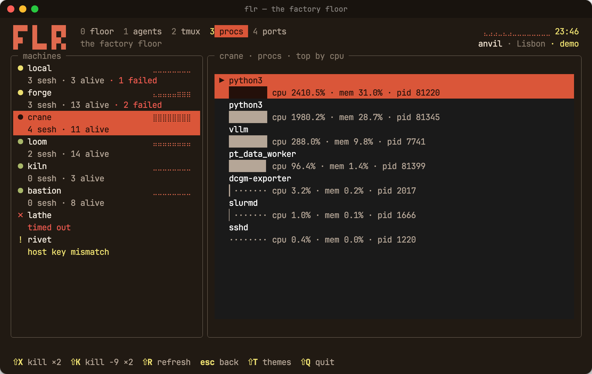</td>
    <td>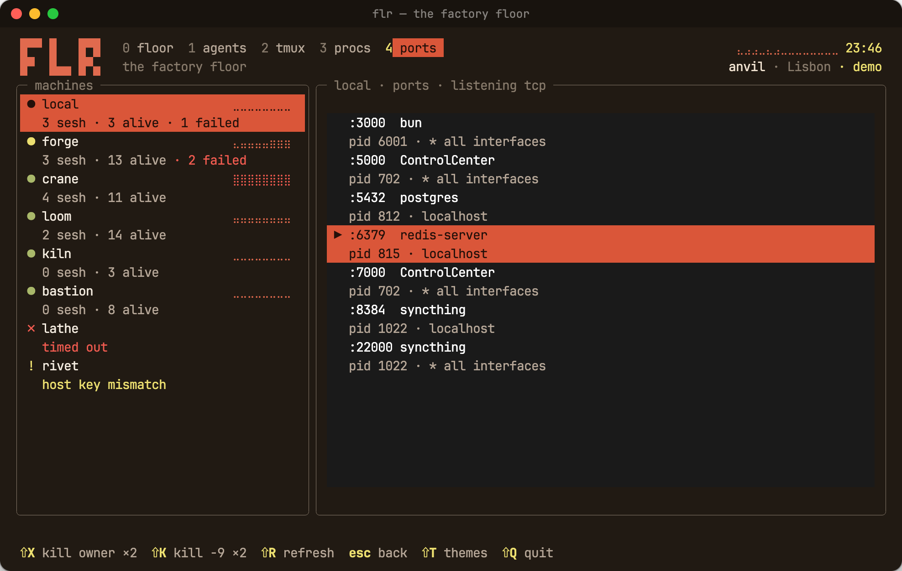</td>
  </tr>
  <tr>
    <td align="center"><b>procs</b> — top by CPU, two-press kills</td>
    <td align="center"><b>ports</b> — who's listening, and on what</td>
  </tr>
</table>

**The keyboard contract**: plain **letters jump between hosts** — type `fo`
and you're on `forge`, from any tab; the same letter again cycles through
every host starting with it. **Arrows move**, **digits switch tabs**, and
actions live on shifted letters (`⇧R` restart, `⇧X` kill …) or symbols.
`enter` on a machine moves focus into the section pane; `esc` steps back, and
`esc` again (or `0`) returns to the floor.

Attaching suspends the TUI, hands your terminal to `ssh -t … tmux attach`, and
resumes when you detach (`ctrl-b d`). Inside tmux locally it uses
`switch-client` instead of nesting.

Agents whose name matches the `agentHide` substrings in
`~/.config/flr/config.json` (default: `["com.apple."]`) stay hidden until you
press `⇧A`.

## instrumentation

The floor is live, drawn in cell-space vectors (braille strip charts,
eighth-block meters) so it works in every theme and over ssh/tmux:

- **the pulse** — load history as a braille strip chart: a small trace in the
  masthead, a full one per machine in **info**. Every reachable host is
  sampled over the ssh mux every 5s, so each machine row in the left rail
  carries its own live mini-trace. Readings shift amber past 70% of cores,
  red past 100%.
- **state lights** — `●` up (amber when agents are failing) · `✗` unreachable
  (`timed out`, `no route`, …) · `!` ssh is blocking *you* (host key, auth) —
  the host itself may be fine. The info pane shows the raw ssh error, a hint
  with the next step, and how old the probe is.
- **hostmarks** — a deterministic block-art emblem per machine (hashed from
  its name), shown as a state-colored badge in the info pane corner.

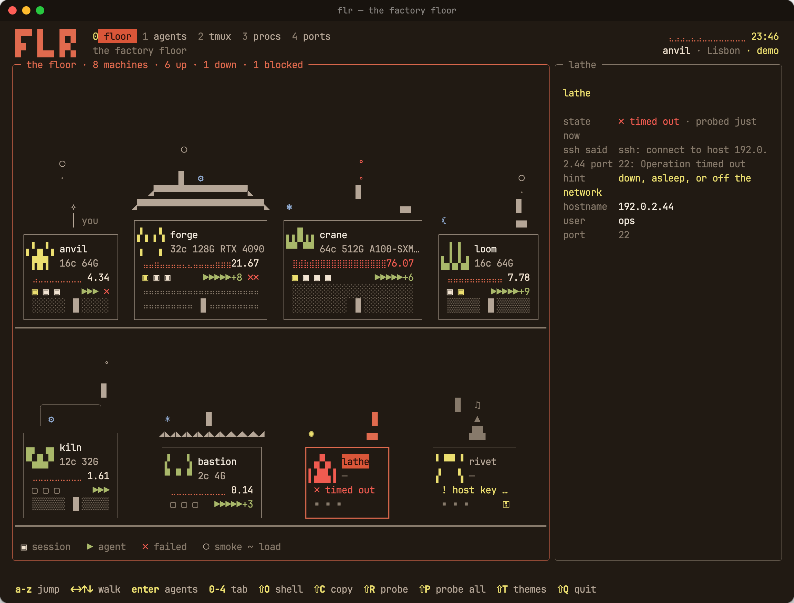

## keys

- **anywhere**: `a`–`z` jump to a host by name (`backspace` edits, `esc` clears) · `0`–`4` / `tab` switch tab · arrows navigate · `⇧O` shell on the selected machine (local or ssh) · `⇧C` copy its ssh cmd · `⇧P` probe the whole floor · `⇧T` themes · `⇧Q` / `ctrl-c` quit
- **floor**: `←→↑↓` walk the buildings · `enter` into the machine's agents · `⇧R` probe it
- **machines rail**: `enter`/`→` focus the section · `esc` back to the floor · `⇧R` probe
- **agents**: `⇧R` restart · `/` filter · `⇧A` show hidden · local only: `enter` run now · `⇧U` load/unload · `⇧L` log tail
- **tmux**: `enter` attach · `⇧X`×2 kill · `esc`/`←` back to machines
- **procs**: `⇧X`×2 kill (TERM) · `⇧K`×2 force kill (KILL) · `⇧R` refresh
- **ports**: `⇧X`×2 kill the owning process · `⇧K`×2 force kill · `⇧R` refresh

## themes

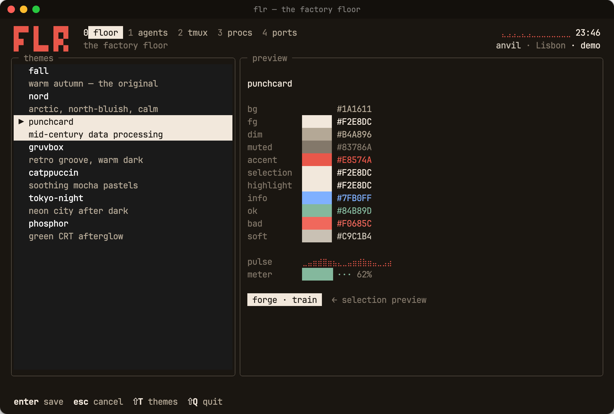

`⇧T` opens the theme picker — navigating live-previews each theme across the
whole UI; `enter` saves (to `~/.config/flr/config.json`), `esc` reverts.

Seven hand-tuned themes: `fall` (default, warm autumn — every screenshot
above), `nord`, `punchcard` (mid-century IBM/Olivetti), `gruvbox`,
`catppuccin` (mocha), `tokyo-night`, and `phosphor` (green CRT).

<table>
  <tr>
    <td>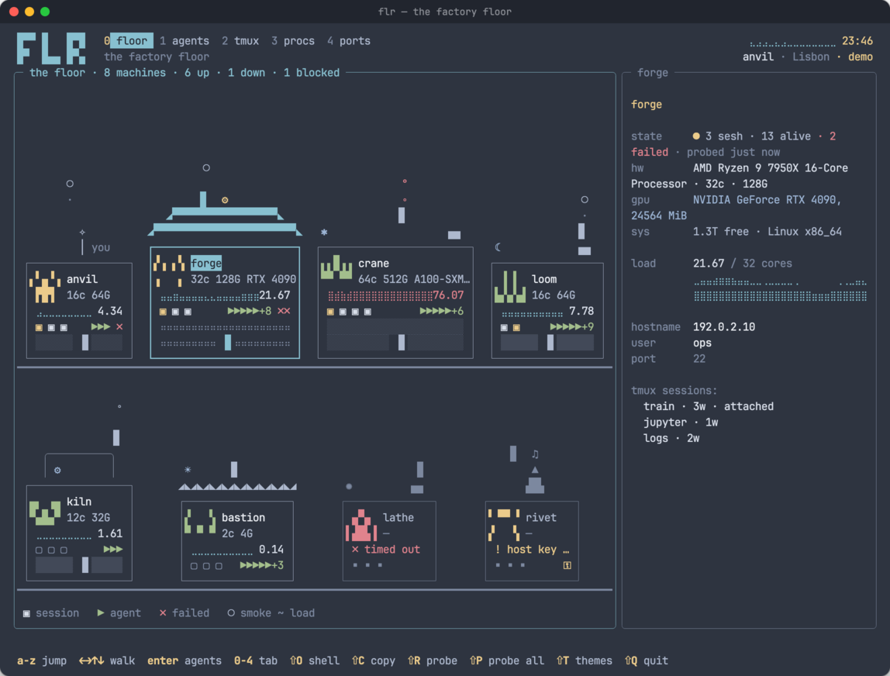</td>
    <td>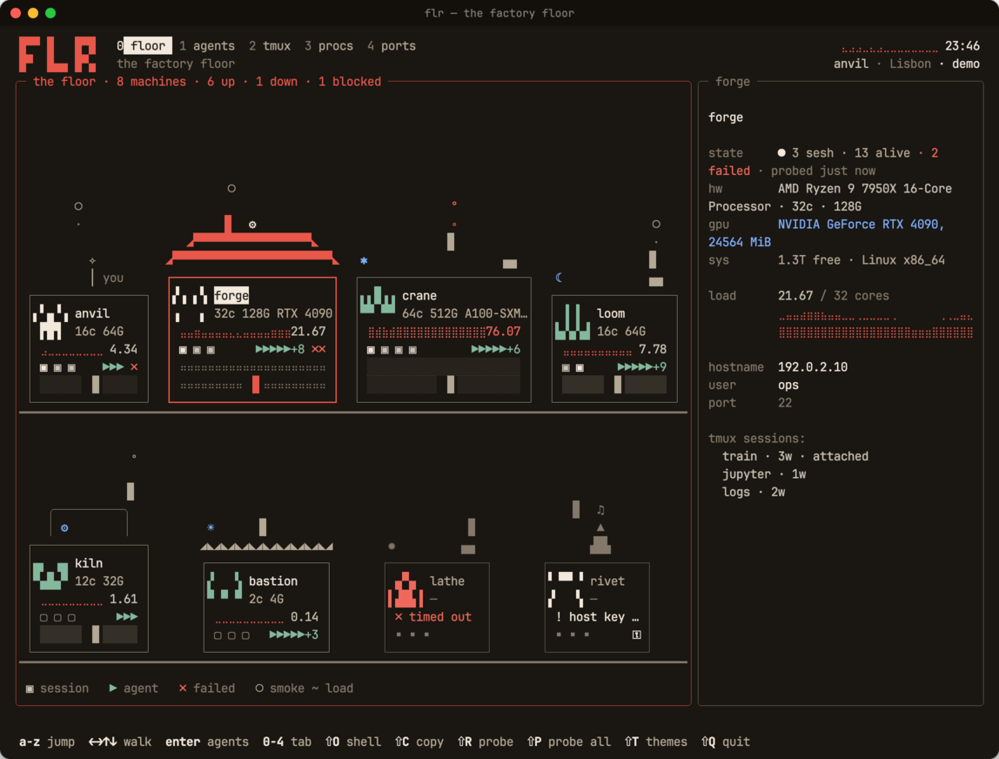</td>
    <td>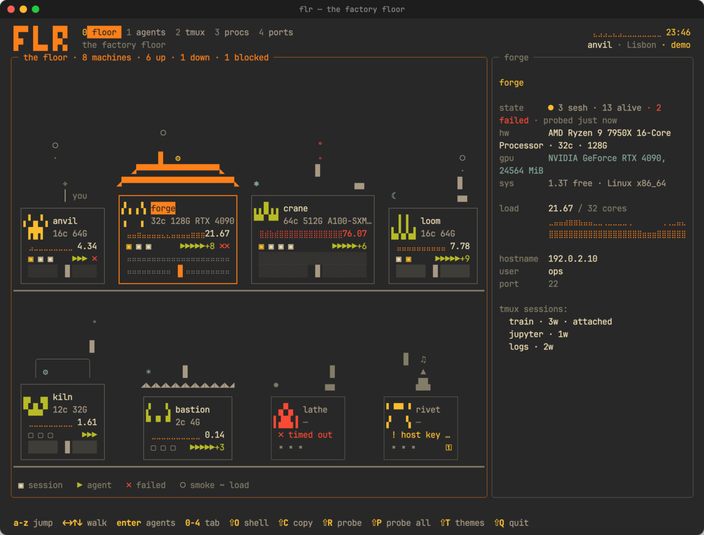</td>
  </tr>
  <tr>
    <td align="center">nord</td>
    <td align="center">punchcard</td>
    <td align="center">gruvbox</td>
  </tr>
  <tr>
    <td>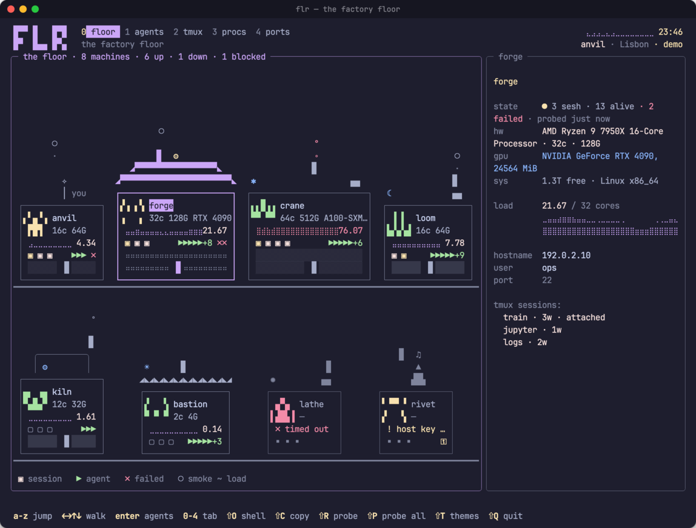</td>
    <td>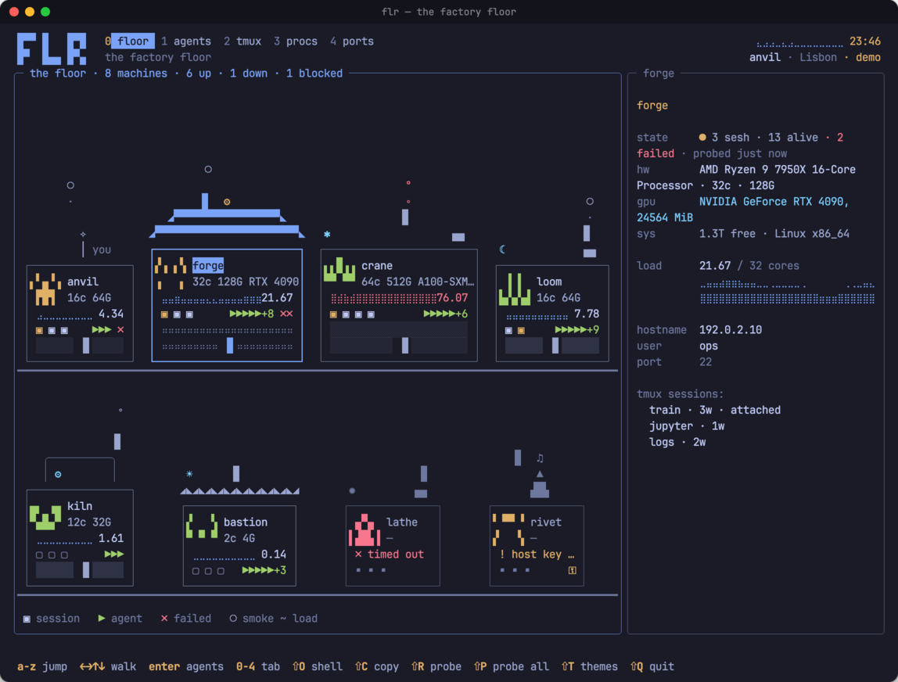</td>
    <td>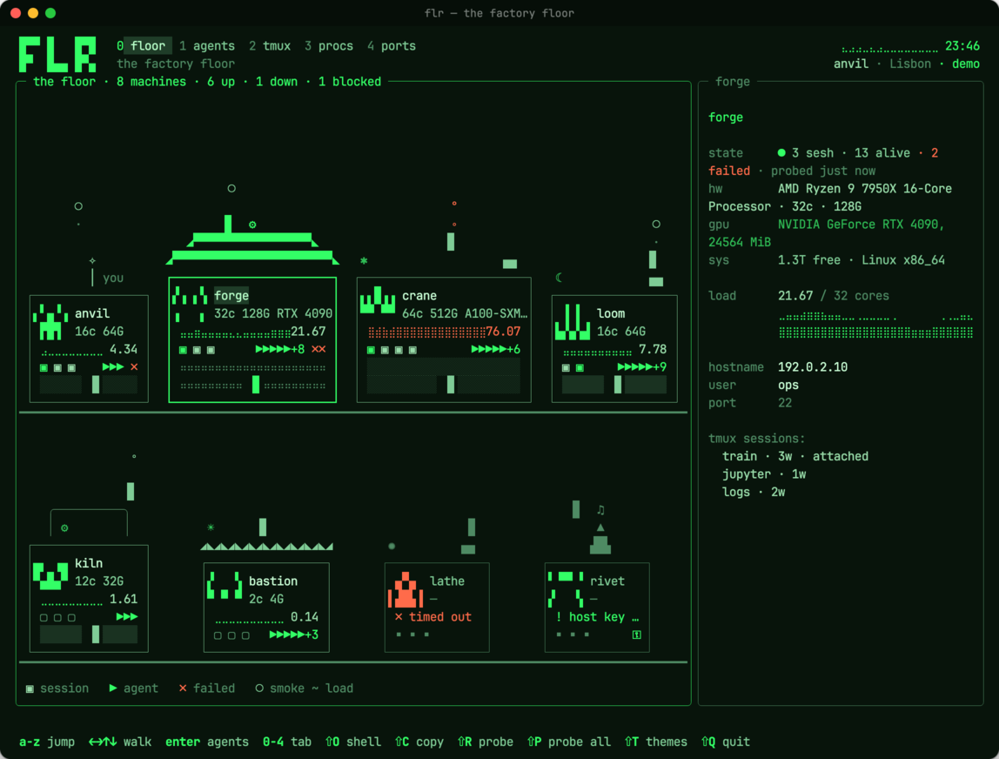</td>
  </tr>
  <tr>
    <td align="center">catppuccin</td>
    <td align="center">tokyo-night</td>
    <td align="center">phosphor</td>
  </tr>
</table>

Each theme owns its background and a three-step text ramp (`fg` / `dim` /
`muted`), with every token WCAG-checked against that canvas — `bun test` runs
the contrast contract (`src/theme.test.ts`), so readability survives tuning.

## notes

- Host probes are one ssh round-trip each (`BatchMode`, never prompts); all
  ssh goes through ControlMaster multiplexing, so repeat operations take
  ~15ms. The connect timeout is 20s — long enough for a multi-hop
  `ProxyJump` chain plus a Mac waking from sleep on the incoming packet, so
  a genuinely dead host takes that long to go dark.
- Remote tmux commands force `TERM=xterm-256color` so hosts without your
  terminal's terminfo (looking at you, `xterm-ghostty`) still attach.
- Remote agent restarts first try without a tty (`systemctl restart` /
  `launchctl kickstart -k gui/…`). If the unit needs root, the status bar
  offers a second `⇧R` that re-runs it through `ssh -t … sudo` so the
  password prompt reaches you.
- Ports come from `ss -ltnp` (Linux) / `lsof -iTCP -sTCP:LISTEN` (macOS).
  Without root they only reveal owning pids for your own processes — rows
  showing `pid ?` belong to another user and can't be killed from here.
- Demo mode (`bun run demo`, or `FLR_DEMO=1`) swaps the data source for a
  fictional fleet (`src/demo.ts`); attaches, kills and restarts only say what
  they would have done.
- Headless visual QA: `bun qa.tsx [default|floor|jump|machine|procs|ports|themes|fail|remote|soak]`
  renders the real app with opentui's test renderer against the demo fleet
  and prints the frame — no terminal takeover. Add `--live` to probe your
  real machines, `--size=140x40` to change the canvas.
- Logs: `~/Library/Logs/flr.log` (macOS) / `~/.local/state/flr/flr.log` (Linux).
- The local agents view is macOS-only for now (launchd); remote agents work
  on Linux (systemd) and macOS (launchd), and hosts and tmux work anywhere
  Bun runs.

Built with [opentui](https://github.com/sst/opentui) (React reconciler) on Bun.

## license

[Apache-2.0](LICENSE)
